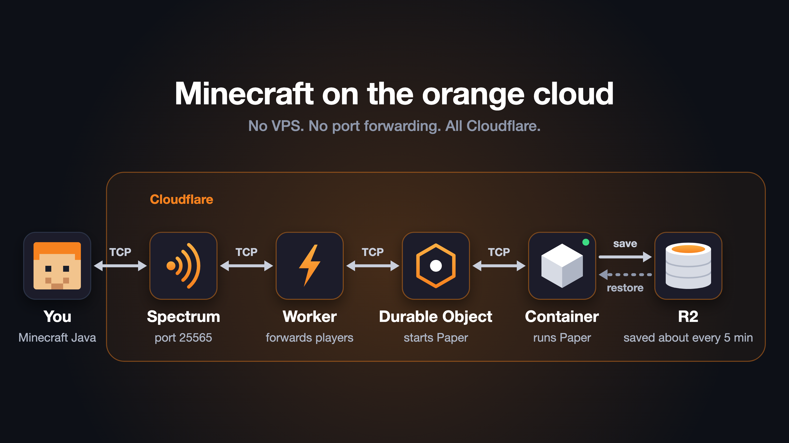

# Minecraft Server on Orange Cloud

Put your Minecraft server behind the orange cloud! No VPS to patch and no ports to forward.

This runs a [Paper](https://papermc.io) server for Minecraft Java entirely on Cloudflare. You deploy it with one command into your own Cloudflare account, and players join at a hostname on your domain.



## How it works

1. [Spectrum takes the player's TCP connection](https://developers.cloudflare.com/spectrum/how-to/route-tcp-traffic-to-a-worker/) on port 25565 and hands it to a Worker.

2. The Worker passes the connection to a Durable Object, which starts the [Paper container](https://developers.cloudflare.com/containers/) and relays bytes to it.

3. After 10 minutes with nobody online, the server saves the world and sleeps. The next player to connect wakes it in about 30 seconds.

4. While it's awake, the container saves the world to R2 about every 5 minutes. Each wake restores the world before Paper starts.

This setup isn't free. The fixed cost is $25 to $30 a month:

- The $5 Workers Paid plan.
- A zone on the [Pro plan](https://www.cloudflare.com/plans/) or Business, because Spectrum doesn't work on Free zones. Pro is $25 a month, or $20 a month billed yearly.

On top of that, you pay for the container only while it's awake. With Cloudflare's [published rates](https://developers.cloudflare.com/containers/platform/pricing/), a server played two hours a day adds about $5 a month, and one that never sleeps adds about $40 to $90.

## Get started

### What you need

- macOS or Linux with glibc. Windows and Alpine aren't supported.
- [Bun](https://bun.sh) 1.4.4 or newer, [Node.js](https://nodejs.org) 22.12 or newer, and [Docker](https://www.docker.com) running.
- A Cloudflare account on Workers Paid, with R2 enabled and a workers.dev subdomain set up. Alchemy keeps its deploy state in a Worker on that subdomain.
- A domain on Cloudflare whose zone is on the Pro or Business plan, or has Spectrum Enterprise. Free zones can't use Spectrum.
- To accept the [Minecraft EULA](https://www.minecraft.net/eula).

### Steps

1. Install the dependencies.

   ```sh
   bun install --frozen-lockfile
   ```

2. Connect your Cloudflare account. The project deploys with [Alchemy](https://alchemy.run), and this script signs it in.

   ```sh
   bun scripts/setup-alchemy.ts
   ```

   Select **OAuth** when asked how to sign in, keep **All Scopes**, then approve access in your browser. Basic Scopes can't create the Spectrum route. If you have more than one account, pick the one to deploy to.

3. Create a `.env` file. Use a hostname that has no DNS record yet.

   ```dotenv
   MINECRAFT_EULA=true
   MINECRAFT_SPECTRUM_HOST=play.example.com
   MINECRAFT_PLAYERS=Alice,Bob
   ```

4. Deploy. The script shows its changes and asks before applying them. Add `--dry-run` to only preview. The first run, even a dry run, sets up Alchemy's state store in your account.

   ```sh
   bun scripts/deploy.ts
   ```

5. In Minecraft, open **Multiplayer**, choose **Add Server** and enter your hostname. If the server was asleep, the first connection wakes it, so refresh or join again after about 30 seconds.

## Settings

To apply a change, put these in `.env` and deploy again.

| Setting                                         | What it does                                                                                                                                                                                     |
| ----------------------------------------------- | ------------------------------------------------------------------------------------------------------------------------------------------------------------------------------------------------ |
| `MINECRAFT_EULA`                                | Must be `true`.                                                                                                                                                                                  |
| `MINECRAFT_SPECTRUM_HOST`                       | The hostname players join. Clear it and deploy to remove the route.                                                                                                                              |
| `MINECRAFT_PLAYERS`                             | Usernames allowed to join, separated by commas. With the whitelist on, an empty list lets nobody join.                                                                                           |
| `MINECRAFT_WHITELIST`                           | `true` by default. Set `false` to let any Minecraft Java account join.                                                                                                                           |
| `MINECRAFT_VERSION` and `MINECRAFT_PAPER_BUILD` | A version and stable build from [Paper downloads](https://papermc.io/downloads/paper), such as `1.21.11` and `132`. Use 1.21 or newer. Set both or neither. The default is Paper 26.3 build 257. |

To run a separate server with its own world, pass `--stage <name>` to `scripts/deploy.ts`. Each stage needs its own hostname. Pro and Business zones allow one Spectrum route to a Worker, so a second public stage needs another zone unless you have Spectrum Enterprise. A world can't move to an older Minecraft version, so use a new stage for that.

## Manage your server

To download your world, open **R2** in the Cloudflare dashboard, open the `backupBucket` the deploy printed, and download `survival/latest.tar.gz`.

To shut down and stop paying for the container:

```sh
bun alchemy destroy --stage production --profile default scripts/stack.ts
```

Use the same `--stage` and `--profile` you deployed with. That command keeps the R2 bucket so your world isn't lost by accident. Deploying again afterwards creates a new, empty bucket. To bring the world back:

1. Deploy with `MINECRAFT_SPECTRUM_HOST` cleared, so nobody can start a new world.
2. Copy `survival/latest.tar.gz` from the old bucket to the same path in the new one.
3. Set the hostname again, deploy, and join to check the world.

Delete the old bucket only after that.

## Limits

- One world per stage, and no console, plugins or mods.
- Only the latest checkpoint is kept. If the container stops uncleanly, you lose the play since the last successful save. The loss is usually a few minutes, but longer if saves to R2 were failing.
- The world and a compressed copy of it must fit together on the container's 12 GB disk.
- Any Minecraft connection wakes the server, including server list refreshes. Port scans that send no Minecraft handshake don't. Nothing in the world runs while it sleeps, and bigger worlds take longer to wake.
- One Spectrum route to a Worker per Pro or Business zone.
- Spectrum routes to Workers are in public beta, and Alchemy is in beta.

## Development

The end-to-end test runs the Worker and Paper locally and checks that a fresh container restores the world.

```sh
bunx --no-install @sshkeda/check
MINECRAFT_EULA=true bun scripts/e2e.ts
```

Not affiliated with Mojang, Microsoft or Cloudflare.

[MIT](LICENSE)
